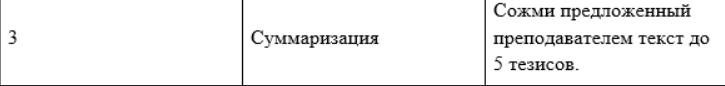
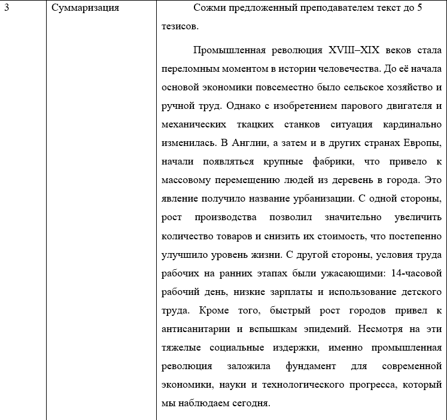
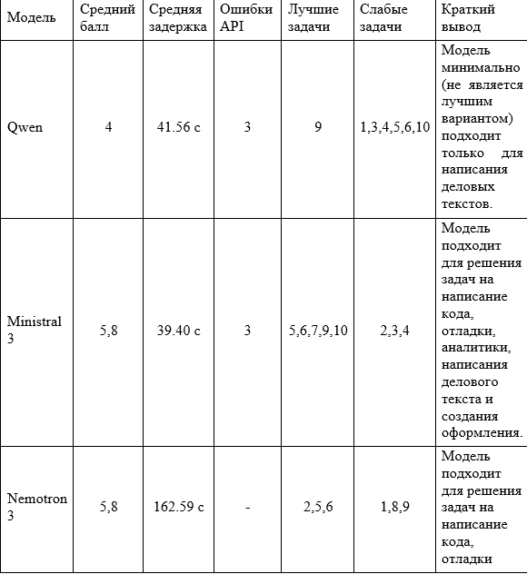
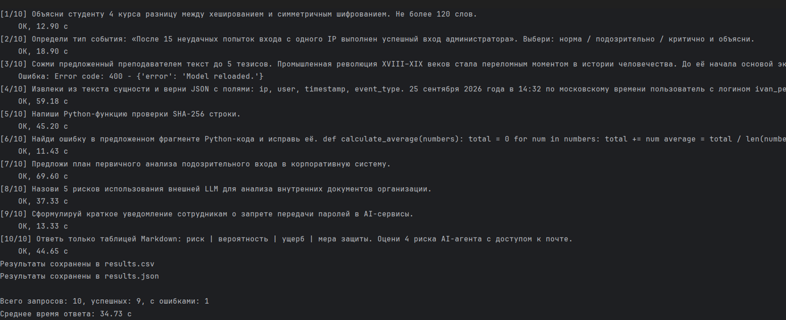

# Лабораторная работа №1
## Тема
Первое знакомство с большими языковыми моделями LLM.

## Цель работы
Освоить базовый программный цикл взаимодействия LLM и научится сравнивать несколько моделей на одинаковом наборе заданий

## Задача
1. Изучить теорию, представленную в методичке.
2. Выбрать три модели для сравнения.
3. Подготовить тестовый набор данных для произведения промптов на каждой LLM.
4. Автоматизировать код, позволяющий взаимодействовать с моделями через Local Server LM Studio.
5. Каждую модель по очереди загрузить в Local Server LM Studio, произвести через нее 10 наборов данных и проанализирвоать по критериям.
6. Сделать выводы на основе результатов сравнения.
7. Ответить на контрольные вопросы, поставленные в лабораторной работе.
8. Оформить лабораторную работу согласно требованиям.

## Используемые технологии
- Python 3.11.9
- PyCharm
- LM Studio
- OpenAI (библиотека)
- dotenv
- pathlib

## Структура
## Структура проекта
```text
data/
src/
results/
screenshots_for_readme/
.env
README.md
requirements.txt
```

## Модели
&emsp;&emsp;**Название моделей:** Qwen (qwen2.5-v1-3b-instruct), Ministral 3(mistralai/ministral-3-3b), Nemotron 3(nvidia/nemotron-3-nano-4b)  
&emsp;&emsp;**Способ запуска:** у всех моделей единый способ запуска - посредством выполнения Python-скрипта, обращающегося к LM Studio в режиме Local Server.  
&emsp;&emsp;**Облачная/локальная:** все модели в данной работе являются локальными.   
В рамках данной лабораторной работы не предусматриваются какие-либо выделяющиеся параметры, влияющие на ход задания.

## Данные

&emsp;&emsp;Данные для работы были помещены отдельно в файл test_requests.txt  
&emsp;&emsp;Набор тестовых данных был взят из методического документа.   
&emsp;&emsp;Для получения корректного ответа от модели, некоторые запросы были дополнены тестовой информацией(вопрос 3,4,6).  
&emsp;&emsp;Тестовые данные уже помещены в программу из main.py.  
&emsp;&emsp;Иные тестовые данные нужно поместить на место старых, в часть кода, представленный ниже
```python
if __name__ == "__main__":
    prompts = ["Расположение тестовых данных"]
```

## Описание решения
**Этап 1**

Изучение теории, подготовка тестовых запросов и выбор моделей.  
На данном этапе была выполнена подготовка к работе над заадачей:  
**1.1 Изучение теории**  
&emsp;&emsp;Для грамотного выполнения заданий была изучена теория, представленная в методическом документе.   
&emsp;&emsp;Для выполнения лабораторной работы для себя я выявила информацию о том, что именно API позволяет 
формировать запрос для сервера модели и получать от него ответ.  
&emsp;&emsp;Важно было принять к сведению информацию о разграничении ролей сообщения, 
которые, впоследствии используются в коде (конкретно system и user):
system, задающий правила и контекст поведения модели, user, содержащий 
запрос пользователя и assistant, 
содержащий предыдущие ответы пользователя, 
которые могут использоваться в истории диалога.  
&emsp;&emsp;Для сравнения моделей между собой необходимо собирать ответы на одни и те же запросы, 
сформированные из разных категорий: качество ответа зависит от типа задачи.
&emsp;&emsp;Важным напоминанием также является требование 
не помещать API-ключ 
и иную чувствительную информацию в 
исходный код, чтобы не допустить 
неконтролируемый доступ к использованию запросов.
&emsp;&emsp; Изучив информацию, перейдем к выбору модели и подготовке тестового набора запросов.  
**1.2 Выбор моделей**  
&emsp;&emsp;В рамках данной лабораторной работы была предоставлена возможность выбора любых 2-3-х моделей.  
&emsp;&emsp;В данном случае выбор был сделан исходя из возможностей компьютера, на котором проводилась работа: были взяты модели небольшого размера (от 2.84 до 3.04GB)
**1.3 Подготовка тестовых наборов запросов**  
&emsp;&emsp;В методическом документе был представлен рекомендованный тестовый набор запросов, который и был взят в основу для получения результатов.  
&emsp;&emsp;3,4,6 запросы были дополнены информацией ввиду необходимости правильного формулирования запроса (Рисунок 1):

&emsp;&emsp;Рисунок 1 - Исходный запрос

&emsp;&emsp;На данном рисунке имеется рекомендованный запрос: "Сожми предложенный преподавателем текст до 5 тезисов", 
к которому не был приложен текст, из-за чего моель требовала дополнительных данных.

&emsp;&emsp;Рисунок 2 - Дополненный запрос

**Этап 2**  
&emsp;&emsp;Далее был реализована практическая часть задания: подготовка кода и непосредственное сравнение трех моделей.  
**2.1 Подготовка кода**  
&emsp;&emsp; В методическом документе был представлен готовый код для работы и часть для его автоматизации. 
&emsp;&emsp; Полный код можно увидеть в main.py.  
&emsp;&emsp;Фрагменты ключевого кода, внедренные в исходный код для автоматизации:  
&emsp;&emsp;**Указание папки, в которую будут попадать ответы на запросы в формате .csv и .json:**
``` python 
BASE_DIR = Path(__file__).resolve().parent
OUTPUT_DIR = BASE_DIR.parent / "results"
OUTPUT_DIR.mkdir(parents=True, exist_ok=True)
```
&emsp;&emsp;**Функция сохранения результатов в .csv:**
``` python 
def save_to_csv(results: list[dict], path: str | Path = OUTPUT_DIR / "results.csv") -> None:
    fieldnames = ["model", "prompt_id", "latency", "answer", "error"]
    with open(path, "w", encoding="utf-8", newline="") as f:
        writer = csv.DictWriter(f, fieldnames=fieldnames)
        writer.writeheader()
        writer.writerows(results)
    print(f"Результаты сохранены в {path}")
```
**Функция сохранения результатов в .json:**

``` python 
def save_to_json(results: list[dict], path: str | Path = OUTPUT_DIR / "results.json") -> None:
    with open(path, "w", encoding="utf-8") as f:
        json.dump(results, f, ensure_ascii=False, indent=2)
    print(f"Результаты сохранены в {path}")
```

**Обработка каждого промпта посредством цикла и обработка ошибок в случае 
возникновения каких-либо проблем на стороне сервера модели:**
``` python 
for i, prompt in enumerate(prompts, start=1):
    print(f"[{i}/{len(prompts)}] {prompt}")
    try:
        answer, latency = ask_model(prompt)
        results.append({
            "model": MODEL_NAME,
            "prompt_id": i,
            "latency": round(latency, 3),
            "answer": answer,
            "error": None,
        })
        print(f"    OK, {latency:.2f} c")
    except Exception as exc:
        results.append({
            "model": MODEL_NAME,
            "prompt_id": i,
            "latency": None,
            "answer": None,
            "error": str(exc),
        })
        print(f"    Ошибка: {exc}")
 ```
**Сохранение всех результатов в .csv и .json**
``` python 
save_to_csv(results)
save_to_json(results)
 ```
Выделение списка успешных и проваленных запросов:
``` python 
ok = [r for r in results if r["error"] is None]
failed = [r for r in results if r["error"] is not None]
 ```
**2.2 Сравнение трех выбранных моделей**
В результате анализа результатов мы получаем следующую таблицу (Рисунок 3)

&emsp;&emsp;&emsp;&emsp;Рисунок 3 - Сводное сравнение моделей
Ошибки:
Ограничения:

## Запуск

&emsp;&emsp; Переменные окружения из .env:
```text
LLM_API_KEY=
LLM_BASE_URL=
LLM_MODEL=
```
&emsp;&emsp; Для тестирования последующих моделей необходимо переименовать файл .csv и .json и сменить идентификатор модели на требуемый(LLM_MODEL=)  
Ввод тестовых данных (В рамках данной работы тестовые данные были взяты 
из методического документа. Для получения корректного ответа от модели, 
некоторые запросы были дополнены тестовой информацией(вопрос 3,4,6)).
Результат работы программы (Рисунок 4)

&emsp;&emsp;&emsp;&emsp;Рисунок 4 - Успешный запуск программы

## Результаты
&emsp;&emsp;Более подробные результаты ответов моделей представлены в .csv и .json файлах:  
**Для Qwen:**
  
  

**Для Ministral 3:**
  
  

**Для Nemotron 3:**
  
  


## Вывод
&emsp;&emsp;В данной работе сравнивались три модели: Qwen (qwen2.5-vl-3b-instruct), Mistralai 3(mistralai/ministral-3-3b) и Nemotron 3(nvidia/nemotron-3-nano-4b).  
&emsp;&emsp;Модель Qwen (qwen2.5-vl-3b-instruct) показала хороший результат только на типе задач «Аналитика» и «Деловой текст».  
&emsp;&emsp;Модель Mistralai 3(mistralai/ministral-3-3b) лучше справлялась с такими задачами, как написание кода, отладка, аналитика, создание делового текста и текста с определенным оформлением. Имеет самую низкую среднюю задержку из всех, выдает промпты более подробно, в рамках инструкции system prompt.   
&emsp;&emsp;Модель Nemotron 3 (nvidia/nemotron-3-nano-4b) единственная смогла обработать и выполнить задачу суммаризации. Также она показала хорошие результаты на классификации, написании кода и отладке.  
&emsp;&emsp;В результате выполнения работы был получен вывод о том, что каждая модель справляется с различными типами задач по-разному: какие-то запросы одна модель способна выполнить лучше других, какие-то не способна выполнять, на каких-то может галлюционировать.  
&emsp;&emsp;Исходя из этого, можно сделать вывод о том, что перед внедрением LLM-модели в бизнес-приложение, необходимо проанализировать ее – насколько она будет подходить под требуемые задачи. При этом анализ должен быть сравнительным: недостаточно оценить одну модель — необходимо рассмотреть несколько кандидатов и выбрать оптимальную.  
